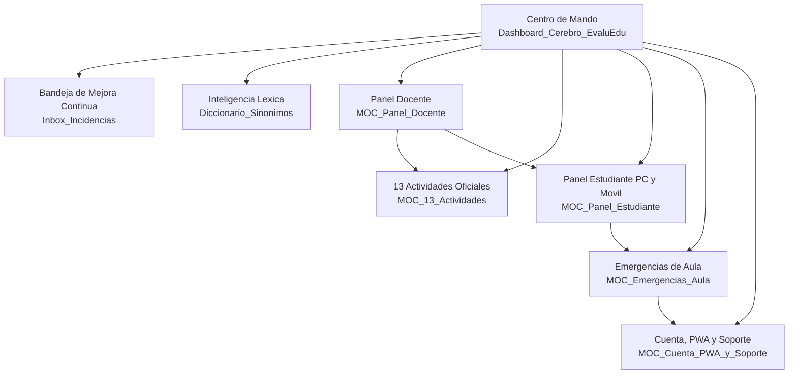

# Centro de Mando · Cerebro del Asistente EvaluEdu

Bóveda de conocimiento oficial para la **Capa 1 (RAG local 100% offline)** y el contexto **GraphRAG de Capa 2** del asistente docente de **EvaluEdu**.

Cada nota representa una unidad atómica verificada contra el código fuente de EvaluEdu y la experiencia real en **PC y celular**. Puedes abrir `src/knowledge/` directamente como un vault en **Obsidian** para auditar su **Vista de Grafo (*Graph View*)** y añadir nuevas soluciones sin tocar código TypeScript.

---

## Mapa del Cerebro (Grafo Maestro)

---

## Índices Principales (MOCs)

- [[MOC_Panel_Docente]] — Recorrido completo: Inicio, Importar documentos/Drive, Plantillas, Propuestas, Salas, PDF en blanco y Resultados/CSV.
- [[MOC_13_Actividades]] — Contratos, límites exactos, edición docente, calificación y uso estudiantil de los 13 formatos oficiales.
- [[MOC_Panel_Estudiante]] — Ingreso por código, sala de espera, Stepper, cronómetro, comprobante, respaldo offline y diferencias PC vs celular.
- [[MOC_Emergencias_Aula]] — Diagnóstico quirúrgico por síntoma y mensajes literales de error en vivo.
- [[MOC_Cuenta_PWA_y_Soporte]] — Conexión, cola offline docente, sesión expirada, contraseña, instalación PWA y escalamiento.

## Operación y Mejora Continua

- [[Inbox_Incidencias]] — Registro estructurado de dudas o errores no resueltos por el bot para incorporar nuevas notas sin tocar código.
- [[Diccionario_Sinonimos]] — Equivalencias del lenguaje docente y estudiantil para maximizar aciertos en Capa 1.
- Plantillas base: [[Tpl_Guia_Flujo]], [[Tpl_Actividad]], [[Tpl_Emergencia]].

## Recomendaciones para Graph View en Obsidian

1. Activa **"Solo archivos existentes"** (*Existing files only*) para comprobar que no existan enlaces rotos.
2. Filtra `-path:00_Meta/Plantillas` si deseas ocultar las plantillas vacías del grafo operativo.
3. Agrupa por color según carpeta (`01_Panel_Docente`, `02_13_Actividades`, `03_Panel_Estudiante`, `04_Emergencias_Aula`, `05_Cuenta_PWA_y_Soporte`) para ver los 5 clústeres del cerebro.
